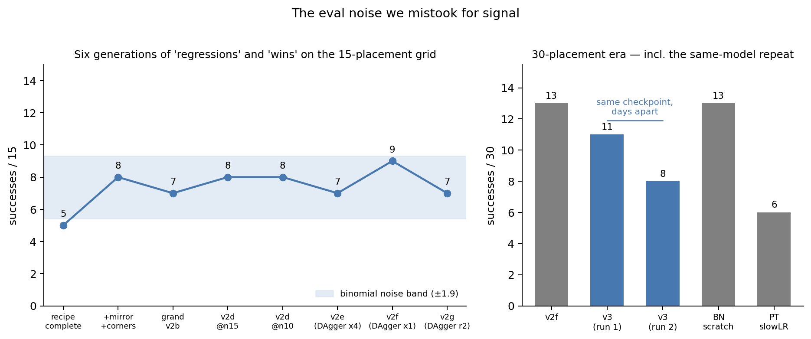
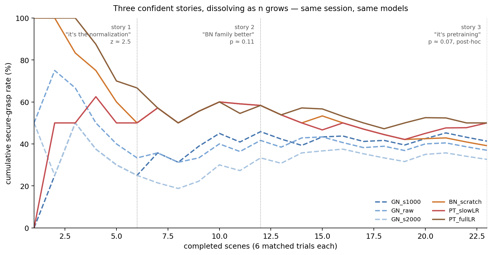

# How do you know your robot got better? (part 2 — measuring the evaluation)

*DRAFT — companion to Part 1 (training a diffusion policy on a $300 arm
from 0% to ~43%). This part is about the "~". We set out to rank six
model variants and ended up measuring our evaluation instead — at four
levels, down to the physics of why two identical grasp attempts disagree
27% of the time. If Part 1 was about making the robot better, Part 2 is
about how hard it is to know whether you did.*

---

## 0. Setup, for readers arriving here first

- One SO-101 follower + leader, Raspberry Pi host, $60 fisheye wrist
  camera, wrist-only Diffusion Policy, task: "put the red block into the
  bin." By the end of Part 1 we had six trained variants of the final
  recipe differing only in vision encoder configuration (from-scratch vs
  ImageNet-pretrained, GroupNorm vs BatchNorm, fine-tuning LR), cleanly
  ordered by validation loss, and we wanted to know which was actually
  best on the robot.
- Spoiler shape: every evaluation instrument we aimed at that question
  broke in an instructive way, and the instrument we finally built
  answered a different — better — question.

## 1. The noise hierarchy, discovered the hard way

- **Level 1: the 15-placement grid.** Our workhorse eval (5 placements x
  3 regions, scored by hand) oscillated 7–9/15 across six model
  generations. We "diagnosed" each swing and shipped a data fix for it.
  At ~50% success, the binomial noise on 15 trials is ±1.9 — we were
  doing regression analysis on coin flips.

- **Level 2: the 30-placement check.** Doubling the grid deflated our
  champion from 9/15 (60%) to 13/30 (43%) — the high roll regressed on
  schedule.
- **Level 3: the same-model repeat.** The decisive humiliation: the
  *identical checkpoint*, re-evaluated on the same protocol days apart,
  scored 11/30 then 8/30. Nothing changed but time and dice. Almost every
  model comparison we had ever interpreted was inside this band.
- **Level 4: the rig drifts.** Transport-drop failures appeared in *all*
  sessions of one week and *none* of the earlier ones — across different
  models. Block edges wear, gripper pads polish, screws loosen. Cross-era
  comparisons carry environmental drift on top of sampling noise.
- Power math nobody wants to hear: resolving a 30%-vs-45% success gap at
  80% power needs ~170 trials per model. By hand, at ~90 s per episode,
  that is a full day per model pair. The 30-trial grid can only resolve
  gaps of ≥ ~10/30.

## 2. Offline metrics — numbers you can compute without running the robot — do not resolve this

- The [ABC report](https://abc.bot/abc.pdf) — Allshire et al., 2026,
  "Scalable Behavior Cloning with Open Data, Training, and Evaluation" —
  shows, with Pearson/Spearman correlations across training runs (their
  Figure 8), that training loss and validation *action error* — run the
  full inference chain on held-out demo observations and measure the
  error of the generated actions — correlate with real-world
  performance, while validation loss does not (for a diffusion policy,
  val loss is a noise-prediction objective, not an action comparison;
  theirs even rises during training while real performance improves). We
  implemented it faithfully: deploy-matched DDIM-10, fixed noise draws
  shared across checkpoints, and the paper's caveat honored (diffusion
  step count held fixed, since fewer steps trivially lowers the error).
- Our first reading was that it failed: it ranked the model with our
  *worst full-task grid score* best. But that reading used the full-task
  grid as ground truth — and section 1 just spent four levels
  demonstrating the full-task grid is noise. Against the grasp benchmark
  (section 3), the picture partially reverses: action error's top pick
  (the low-LR fine-tuned model) *co-led* the grasp table, while
  validation loss's confident favorite finished mid-pack and its
  designated worst model (the naive full-LR fine-tune) co-led. Scored
  against our best behavioral instrument, action error called the winner
  and val loss called it backwards — though action error also ranked
  that same co-leading full-LR model dead last, so neither metric's full
  ordering survives.
- The honest statement of what we can and cannot conclude at our noise
  floor: we cannot *validate* any offline metric's fine-grained ordering
  (the grasp-rate differences among these models are themselves within
  overlapping confidence intervals). What we can say is that the two
  offline metrics disagree with each other, that validation loss's
  ordering pointed the wrong way behaviorally, and that no slicing we
  tried — grasp-phase-only, transport-only, single-action-dimension
  (an idea independently published as Critical Interval MSE
  [arXiv:2606.29898]) — changed either metric's verdict. Offline metrics
  measure reproduction of demonstrator actions on demonstration states;
  the failures that matter live in states the policy creates for itself.
- So what are offline metrics still good for? Less than we wanted to
  claim. Catching outright *bugs*, certainly — when we once evaluated
  checkpoints without their normalization preprocessor, val loss read
  ~3.45 instead of ~0.02, an unmissable alarm. But even "gross
  degradation" verdicts on real models proved unreliable: the naive
  full-LR fine-tune was flagged by every offline metric in every slicing
  (+14% val loss, +20% action error) — and then co-led the grasp
  benchmark. On this project's evidence, an offline gap of even that
  size is a hypothesis about behavior, not a fact about it. Ranking
  near-peer models is certainly not among offline metrics' powers — in
  either direction.
- Hygiene finding along the way: our val split had silently inherited
  25% kinesthetic episodes — a modality we knew to be unlearnable for
  grasping — through five generations of dataset merges. It didn't change
  rankings, but it diluted every val number we had ever reported. Check
  what your val set is actually made of.

## 3. Building an instrument that could actually measure: the grasp benchmark

- Diagnosis: full-task success compresses four distinct skills —
  approach, grasp execution, transport, recovery — into one pass/fail
  per 60–90 s episode. How those skills correlate across models is
  unknown, and that's precisely the problem: unless they happen to be
  strongly aligned, a compound score can't attribute a difference to
  any of them at affordable trial counts. (The one hint we had pointed
  the wrong way for compound scoring: our worst full-task model later
  co-led the grasp test — within noise on both instruments, but hardly
  reassurance that the skills move together.) The weakest link (the
  grasp) is where outcomes are decided, so we built a unit test for it. Design elements,
  each earned by a pilot failure:
  - **Rollout-seeded start states.** A seeding policy (rotating per
    scene) rolls out normally; the operator presses SPACE the moment the
    block enters the gripper opening. The pose and the last two
    observations are captured, and the seeding rollout continues
    uninterrupted — becoming its own first trial. Start states are
    guaranteed on-distribution because a policy generated them.
  - **Ghost-overlay re-placement.** For every subsequent trial the arm
    returns to the captured pose and the operator aligns the block to a
    50/50 blend of live camera vs captured reference (plus a difference
    view that goes dark when aligned). Pixel-accurate re-placement, no
    table marks, no memory burden. Backlash means the *background* never
    quite aligns — aligning the block-to-gripper relationship is the
    policy-relevant thing, so that's what the overlay optimizes.

  - **Matched blocks, randomized order.** Every model runs on every
    scene back-to-back in shuffled order, so placement variance and rig
    drift are shared, not confounded.
  - **A settled-grasp trigger, a scripted stress, and a human verdict.**
    These policies close, reopen, re-angle, and reseat, so the trial
    ends on a *settled* grasp — 2.5 s of continuous closure (commanded
    or measured), flicker-tolerant — not on first contact. Then a
    scripted, policy-independent stress runs: lift, 4 s hold, pan
    jiggle, identical for every trial, so "grip quality" becomes an
    observable outcome instead of a judgment call. Scoring is a 3-level
    ordinal — 0 never held, 1 acquired but lost, 2 held through the
    stress — and every score was confirmed by the operator with a
    keypress. We tried auto-scoring from the measured gripper width
    (empty jaws close well past block width); it was not reliable
    enough to trust — edge grips read as empty, so the machine's
    reading stayed a suggestion and the human stayed the judge.
  - Calibration keys, resume, per-trial logs, and a fixed per-attempt
    rubric ("one attempt = one settled closure") — details in the repo.
- The experiment shape: **6 checkpoints × 2 attempts per scene × 26
  scenes = 280 scored trials** (23 scenes fully complete across all six
  checkpoints; analysis equalizes to 46 trials per model). The six
  checkpoints, and why each earned its slot:

| checkpoint | what it isolates |
|---|---|
| GN_s1000 | the champion recipe (from-scratch + GroupNorm) |
| GN_s2000 | same recipe, different seed — the model-seed noise floor |
| GN_raw | the same training run as GN_s1000, raw instead of EMA weights — a pure EMA ablation |
| BN_scratch | from-scratch with BatchNorm — isolates normalization |
| PT_slowLR | ImageNet-pretrained, backbone at 10× lower LR — the DP paper's prescription |
| PT_fullLR | ImageNet-pretrained, naive full-LR fine-tune — intended as the "should lose" control |

Two attempts per model per scene are what make the same-state flip
rate (section 4) measurable at all.
- Throughput: ~25–35 s per trial including re-placement. 276 scored
  trials across 26 scenes in a few evening sessions — the trial count
  that the power math demanded and the full-task protocol could never
  afford.

## 4. The flip floor: 27%

- The benchmark's headline wasn't a model ranking. Across 139
  same-model, same-scene trial pairs — identical weights, identical
  captured state, pixel-aligned block — **27% of pairs flipped outcome**,
  almost always maximally: clean secure grasp on one attempt, complete
  miss on the other. We recomputed this rate as the session grew — ~30%
  after 6 scenes, 28% after 12, 27% after 26 — and it barely moved,
  while over the same growing dataset the model *rankings* changed
  story three times (section 5). The flip rate was the one statistic in
  the whole session that behaved like a measurement.
- Mechanism: approach is a visual-servoing attractor that absorbs
  micro-variation; the contact event is a bifurcation that amplifies it
  (which fingertip corner touches first, which side of the friction cone
  the block sits on — switching on sub-millimeter differences that
  backlash alone guarantees); and after contact this hardware is blind —
  no force, no tactile, position-commanded servos pushing open-loop.
  Smooth, then chaotic, then blind. 27% is what that pipeline structure
  measures out to.
- What follows from a 27% flip rate: on this hardware, no policy
  "can grasp" or "can't grasp" — each attempt is a draw with some
  success probability, and the policy only controls what that
  probability is. So comparing policies means estimating probabilities,
  which takes many trials; watching a handful of attempts tells you
  almost nothing. And this is where the mysteries of section 1 came
  from: a 15-trial grid built on attempts that individually flip 27% of
  the time *has* to swing by a couple of successes between runs. The
  swings we spent weeks diagnosing were this coin flip, aggregated.
- The price list that follows (two-proportion test, 80% power): telling
  a 60% grasper from a 40% one takes **~100 trials per model** — a
  single evening with this harness, if you compare just two models. A
  15-point gap costs ~170 per model; a 10-point gap ~390; a 5-point gap
  ~1,550 (required trials grow as 1/gap²). Our own session spent 46
  trials per model across six models — enough to resolve only ~29-point
  gaps, which is why it correctly refused to rank near-peers. Matched
  scenes discount these numbers somewhat (shared hard scenes cancel
  out), but the shape is the shape: on hardware with a 27% same-state
  flip rate, behavioral certainty is bought in hundreds of trials, not
  tens.
- Pre-registered prediction for the next chapter (written before the
  hardware exists): on a quasi-direct-drive arm, the same-state flip
  rate drops well below 27%. The mechanism decomposes into two halves,
  and the QDD platform attacks both. The *unrepeatable state* half:
  minimal gearing means minimal backlash (the source of the
  sub-millimeter pose lottery), output-side encoders make whatever slop
  remains visible instead of hidden behind motor-side readings, and
  CNC-milled links don't flex under load the way printed plastic does.
  The *blind after contact* half: torque control means a wrong-footed
  contact yields instead of launching the block, and motor-current
  sensing gives the system a post-contact signal this arm never had.
  If the flip rate on the new arm doesn't drop, our whole mechanistic
  story is wrong — that's the point of writing the number down now.

## 5. Watching ourselves invent three wrong stories

- The benchmark also recorded, in time-lapse, what underpowered data does
  to careful people.

  - **12 trials per model (6 scenes):** all three BatchNorm variants
    above all three GroupNorm variants, pooled 57% vs 28%, z≈2.5. We drafted a normalization
    mechanism (EMA/BatchNorm-buffer interaction) with literature support.
  - **24 trials per model (12 scenes):** the BN-family gap softened to p≈0.11 but "held
    direction." The story survived, upgraded with a phase-decomposition
    narrative.
  - **46 trials per model (23 scenes):** the family gap dissolved (p≈0.48; the first-half gap
    of +0.40 score points went to −0.05 in the second half), one model
    collapsed from 58% to 39%, and a *different* post-hoc grouping
    (pretrained vs from-scratch) now sat at p≈0.07. Story number three,
    adopted after seeing the data, one comparison among dozens examined.
- The three stories' fates differ in kind, and it matters: stories one
  and two were *falsified* — more data from the same session killed
  them. Story three was never tested. An uncorrected p≈0.07 on a
  grouping chosen after looking at the data is exactly the shape of
  evidence that had already fooled us twice, so we ended the session
  declining to believe it rather than disproving it. If
  pretrained-vs-from-scratch grasp quality ever matters, it costs one
  fresh, pre-registered, two-model session (~100 trials each, per the
  price list above); until someone pays that, it is a hypothesis, not a
  finding.
- Every safeguard was in place — matched blocks, randomized order,
  pre-registered read-order, a positive control — and the stories formed
  anyway, because grouping-choice happens between the safeguards. Each
  story came with a plausible mechanism, and the mechanisms' eloquence
  was uncorrelated with their truth (the AI assistant generated them
  fluently; see Part 1's section on working with AI).
- What actually protected us, in the end: pre-committed read-order, a
  positive control whose misbehavior we eventually heeded, seed-pair
  entries (the seed pair, the raw/EMA pair) measuring the noise floor
  *inside* the experiment, and letting the trial count grow past the
  point where the story was exciting.

## 6. What survived, and the protocol we'd start with next time

- Findings that held at full rigor:
  1. The 27% same-state flip floor — the best-measured number the
     project produced.
  2. EMA: +9% validation loss, at every checkpoint, in the cleanest
     possible ablation (same run, two weight views) — and *zero*
     detectable grasp-behavior effect at 46 trials per model. Restore it (it's
     free), but don't expect it to rescue behavior.
  3. No encoder configuration separates at the grasp (33–50%, all CIs
     overlapping) — while validation loss orders the same six models
     decisively. Echoes the Diffusion Policy paper's own fine print:
     "the best performance across different architectures is not large."
  4. Underpowered evals generate confident, evolving, wrong stories —
     three of them, in one session, from us, with the receipts logged.
- The protocol we'd adopt from day one on the next platform:
  - Same-model repeats *first* — measure the flip floor before comparing
    anything.
  - Matched blocks with randomized within-block order; never compare
    across sessions without a bridge arm.
  - Positive control in every session; if it misbehaves, suspect the
    instrument and the rig before inventing science.
  - Unit-test the bottleneck phase (grasp) at high n instead of
    full-task at low n; keep full-task runs for existence proofs
    (recovery works; scanning appeared), which are immune to this whole
    essay.
  - Pre-register groupings; anything discovered post-hoc buys a
    hypothesis, not a finding, and pays for its own fresh session.
- Where this leaves the headline number: Part 1's "~43%" is honest
  precisely because the "~" is now a measured object — ±3/30 sampling, a
  27% per-contact flip floor, and a rig that drifts by the week.
- Repo: [github.com/YosubShin/lerobot_alohamini](https://github.com/YosubShin/lerobot_alohamini); harness:
  [grasp_eval_so101.py](https://github.com/YosubShin/lerobot_alohamini/blob/main/examples/alohamini/grasp_eval_so101.py);
  experiment logs: [docs/experiments](https://github.com/YosubShin/lerobot_alohamini/tree/main/docs/experiments) — every number above has a
  dated entry.

---
*Working notes:*
- tone: same lab-notebook honesty as Part 1; the narrator is the
  cautionary tale
- video: figures/grasp-trial-example.mp4 — the policy phase of one trial
from the wrist POV (handoff at the captured state through settled
grasp, 6.5 s); note clips end at closure — the scripted stress isn't
recorded. Embed in section 3.
- key figures: noise-hierarchy ladder (grid oscillation with binomial
  band); three-snapshot tally evolution (the centerpiece); flip-floor
  schematic (attractor → bifurcation → blind); harness photo/clip of the
  ghost overlay
- pull quotes: "we were doing regression analysis on coin flips";
  "evaluate probabilities, not outcomes"; "the mechanisms' eloquence was
  uncorrelated with their truth"
